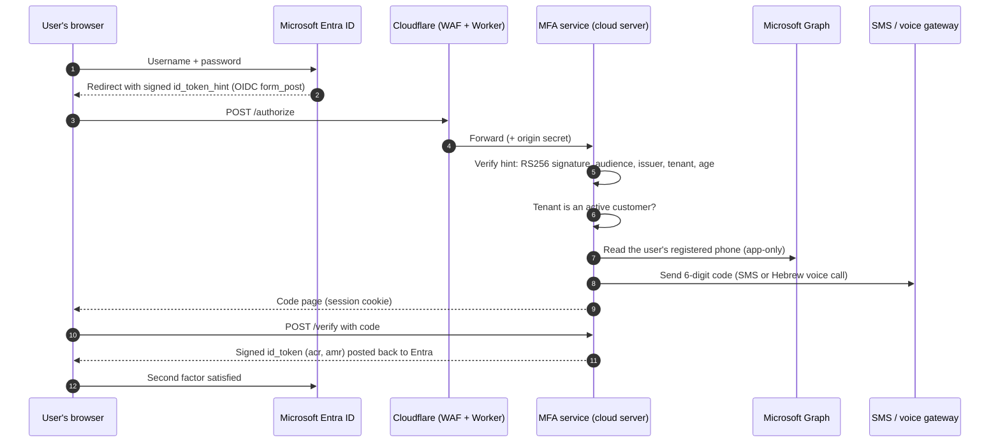

# SMS and voice MFA for Microsoft Entra ID

An **external authentication method** provider for Microsoft Entra ID. After the user enters
their password, Entra hands the sign-in to our service, which sends a one-time code by SMS, or
reads it out in a voice call for phones that cannot receive SMS. Entra accepts the result as a
second factor.

> This folder describes the design. The service source code is not published.

## Why

Microsoft's built-in options lean on the Authenticator app. Many organizations in Israel have
employees on basic or restricted phones that cannot run apps. This provider plugs into Entra's
supported external authentication method extension point, so Conditional Access, sign-in logs
and policies keep working as usual, and codes go out through an Israeli SMS and voice
gateway.

## How a sign-in works

## Security design

**Trust in Microsoft's request**
- The `id_token_hint` must be signed by Microsoft (RS256 only, keys from Entra's JWKS), issued
  for our application, by the user's own tenant, and recent.
- Only tenants that granted admin consent **and** were activated by us can sign in. Consent is
  proven with Microsoft Graph before a tenant is recorded.
- Responses go back only to Entra's registered endpoint; any other `redirect_uri` is refused.

**Codes**
- 6 digits, valid for 5 minutes, single use.
- Codes are never stored: the session keeps an HMAC of the code bound to the phone number and
  expiry, so any instance can check it and nobody can read it back.
- At most 3 attempts per sign-in, and at most 5 codes per user per 15 minutes.
- The attempt is counted and saved before the code is compared. Requests for the same
  session are serialized.

**Web hardening**
- Strict Content-Security-Policy with a per-response nonce, no framing, no referrer, no caching.
- `__Host-` session cookie (HttpOnly, Secure, SameSite=Lax), checked against the form on every
  step.
- Our own tokens are signed with a dedicated RS256 key. Overlapping keys in the JWKS allow
  rotation without downtime.

**Perimeter**
- Cloudflare in front: path allow-list, rate limiting, and TLS 1.2+ only.
- **Origin lock:** the hosting platform's own address is public, so the service refuses any
  request that did not come through our Cloudflare Worker (shared secret). This closes the
  "go around the WAF" route.

**Phishing-resistant option: approved computers only**
For organizations that want it, a code is sent only when the sign-in comes from one of the
organization's computers:
- Each organization's computers carry a client certificate issued by our private CA.
- The browser is sent to a mutual-TLS endpoint on AWS API Gateway, which accepts only
  certificates from that CA.
- The service then checks that the certificate belongs to the same tenant as the user and has
  not been revoked.
- The result counts only together with the session cookie of the browser that started the
  sign-in. On a reverse-proxy phishing site that cookie sits with the attacker, so a check
  passed by the victim's browser cannot be reused.

## Operations

- **Hosting:** a managed Node.js cloud server, with separate development and production
  environments, apps, keys and secrets.
- **State:** a managed cache for short-lived sessions and rate limits, and a managed database for
  customer organizations, sign-in events and revoked certificates.
- **Logs:** structured JSON. They never contain the codes.
- **Code:** Node.js built-ins, plus the hosting platform's SDK.
- **Tests:** about 120 automated tests: end-to-end flows, provider clients, Graph lookup,
  phishing-relay and origin-bypass scenarios.

## Contact

[milabs.co.il](https://milabs.co.il)
